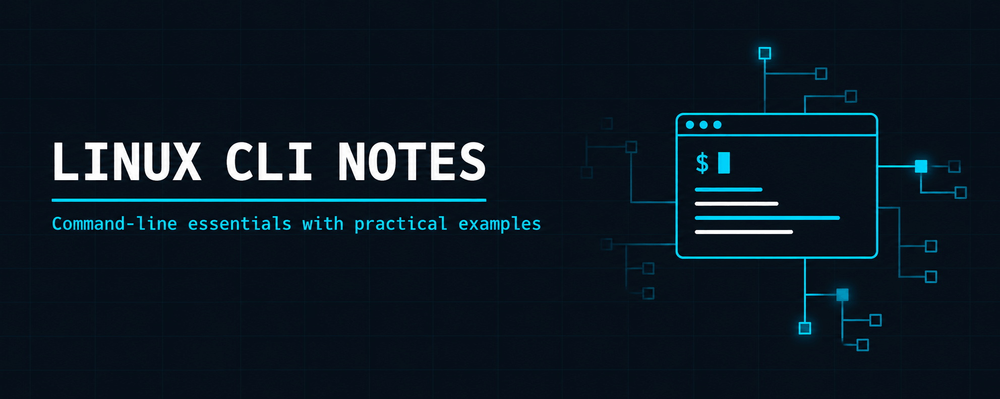

<p align="center">
  
</p>

<h1 align="center">Linux CLI Notes</h1>

<h3 align="center">Command-line essentials with examples: files, processes, permissions, logs, APT and networking</h3>

<p align="center">
  
  
  
  
</p>

<p align="center">
  <a href="#overview"><b>Overview</b></a> ·
  <a href="#modules"><b>Modules</b></a> ·
  <a href="#cheat-sheet"><b>Cheat Sheet</b></a> ·
  <a href="#environment"><b>Environment</b></a> ·
  <a href="#repository-structure"><b>Structure</b></a> ·
  <a href="#resources"><b>Resources</b></a>
</p>

---

## Overview

These are my working notes for the Linux command line, written while practising on Kali Linux. Each module covers one area, explains the commands in tables, shows runnable examples and ends with practice tasks and common mistakes.

| | |
| --- | --- |
| **Practised on** | Kali Linux (Debian-based), bash |
| **Format** | One folder per module, each with its own `README.md` |
| **Each module has** | Command tables · examples · practice tasks · common mistakes |
| **Quick lookup** | [`cheatsheet.md`](./cheatsheet.md) |

## Modules

| # | Module | Focus | Key Commands |
| - | ------ | ----- | ------------ |
| 01 | [Files & Directories](./modules/01-files-and-directories/README.md) | Navigation, creating, copying, moving, deleting | `pwd` `ls` `cd` `mkdir` `touch` `cp` `mv` `rm` `find` |
| 02 | [Compression & Archiving](./modules/02-compression-and-archiving/README.md) | Archives, compression formats, backups | `tar` `gzip` `bzip2` `xz` `zip` `unzip` |
| 03 | [File Viewing & Text Tools](./modules/03-file-viewing/README.md) | Reading, searching, comparing, pipes | `cat` `less` `head` `tail` `grep` `wc` `diff` `sort` `uniq` |
| 04 | [System & Processes](./modules/04-system-and-processes/README.md) | Processes, jobs, resources, services | `ps` `top` `htop` `kill` `df` `du` `free` `systemctl` |
| 05 | [Users & Permissions](./modules/05-users-and-permissions/README.md) | Ownership, rwx, users, groups, sudo | `chmod` `chown` `adduser` `usermod` `sudo` `id` |
| 06 | [System Logs](./modules/06-system-logs/README.md) | `/var/log`, journald, log rotation | `journalctl` `dmesg` `last` `lastb` `logrotate` |
| 07 | [APT Package Management](./modules/07-apt-package-management/README.md) | Installing, updating, removing, troubleshooting | `apt` `dpkg` `apt-mark` |
| 08 | [Networking](./modules/08-networking/README.md) | Connectivity, DNS, ports, remote access | `ip` `ping` `dig` `traceroute` `ss` `curl` `ssh` `scp` |

## Cheat Sheet

| Task | Command |
| ---- | ------- |
| List files with details | `ls -lah` |
| Search text in files | `grep -rin "text" .` |
| Watch a log live | `tail -f file.log` |
| Archive and compress a folder | `tar -czvf backup.tar.gz folder/` |
| Show running processes | `ps aux` |
| Disk and memory usage | `df -h` · `free -h` |
| Make a script executable | `chmod +x script.sh` |
| Update and upgrade packages | `sudo apt update && sudo apt full-upgrade` |
| Show IP addresses | `ip addr` |
| Show listening ports | `sudo ss -tulnp` |

The full list is in [`cheatsheet.md`](./cheatsheet.md).

## Environment

- Kali Linux, or any Debian or Ubuntu based distribution
- A terminal with bash
- A virtual machine is recommended for the practice tasks, because some of them create users, change permissions and delete files

Module 07 applies to Debian-based systems only (APT and dpkg). The other modules work on most Linux distributions.

## Repository Structure

```
linux-cli-notes/
├── README.md
├── cheatsheet.md
├── LICENSE
├── images/                                  # banner and terminal screenshots
└── modules/
    ├── 01-files-and-directories/README.md
    ├── 02-compression-and-archiving/README.md
    ├── 03-file-viewing/README.md
    ├── 04-system-and-processes/README.md
    ├── 05-users-and-permissions/README.md
    ├── 06-system-logs/README.md
    ├── 07-apt-package-management/README.md
    └── 08-networking/README.md
```

## Resources

- [Linux Journey](https://linuxjourney.com/): interactive Linux lessons
- [ExplainShell](https://explainshell.com/): breaks a command into its parts
- [tldr pages](https://tldr.sh/): short, practical man pages
- [Linux Command Library](https://linuxcommandlibrary.com/): searchable command reference

## License

Shared for educational reference.

## Contact

<p align="center">
  <b>Abdul Wahid</b>
</p>

<p align="center">
  <a href="mailto:a.wahid7860668@gmail.com"></a>
  <a href="https://www.linkedin.com/in/abdul-wahid022"></a>
  <a href="https://github.com/abdul-wahid022"></a>
</p>
